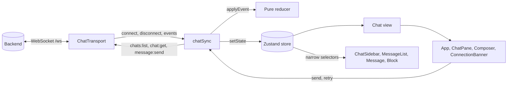

# Scripted AI Chat client

A React and TypeScript client for a scripted, streaming AI chat backend: a sidebar of Chats and an open Chat whose assistant responses stream in as Blocks. The assignment is in [`docs/home-task.md`](docs/home-task.md); the backend contract is in [`backend/PROTOCOL.md`](backend/PROTOCOL.md).

Domain terms (Chat, Turn, Suggestion, Rejected Message, Block, Unknown Block, Snapshot, Sequence Number, Gap) are defined in [`GLOSSARY.md`](GLOSSARY.md) and used throughout this README and the code.

## Contents

- [Run it](#run-it)
- [Test it](#test-it)
- [Deploy](#deploy)
- [Architecture](#architecture)
- [Library choices and alternatives](#library-choices-and-alternatives)
- [How AI was used](#how-ai-was-used)
- [Left out and next steps](#left-out-and-next-steps)

## Run it

Prerequisite: Node.js 24 or later (see `.nvmrc`).

```bash
npm install
npm start
```

`npm start` runs both apps:

- Backend: `http://localhost:4000`, run by `wrangler dev` (`npm start -w backend` on its own)
- Frontend: `http://localhost:5173` (`npm run dev -w frontend` on its own)

The backend keeps all state in memory in one Durable Object. A browser refresh restores every Chat, including one that is responding; restarting the backend resets every Chat to the start of its script.

| Folder | Contents |
| --- | --- |
| [`backend/`](backend) | The scripted backend: a Cloudflare Worker and one Durable Object that speak JSON over a WebSocket. The starter's Socket.IO server was ported to it so the app can be deployed ([ADR-0003](docs/adr/0003-cloudflare-worker-and-durable-object.md)); the scripts and Chat logic are unchanged. |
| [`frontend/`](frontend) | The client. All the work is here. |
| [`docs/`](docs) | The assignment, the [implementation plan](docs/plan.md), [ADRs](docs/adr), and agent configuration. |

### Configuration

| Variable | Where | Default | Purpose |
| --- | --- | --- | --- |
| `VITE_BACKEND_URL` | `frontend/.env.local` | `http://localhost:4000` in development, the page's own origin in a production build | Backend URL used by the frontend. |
| `--port` | `wrangler dev` flag in the backend's `start` script | `4000` | Backend port. |
| `DELAY_SCALE` | `npm start -w backend -- --var DELAY_SCALE:0.2`, or `DELAY_SCALE=0.2` in `backend/.dev.vars` | `1` (`backend/wrangler.jsonc`) | Multiplies every streaming delay. `0.2` is five times faster; `0` is instant. |

## Test it

| Command | What it runs |
| --- | --- |
| `npm test` | Unit tests of every workspace. The backend's protocol tests run against the real Worker, started per test with wrangler's `unstable_startWorker`. |
| `npm run test -w frontend` | Frontend unit tests once (Vitest, React Testing Library, jsdom). |
| `npm run test:watch -w frontend` | The same in watch mode. |
| `npm run lint -w frontend` | oxlint, warnings fail. |
| `npm run typecheck -w frontend` | `tsc --build`. |
| `npm run build -w frontend` | Typecheck and production build. |
| `npx -w frontend playwright install chromium` | Downloads the browser for Playwright, once. |
| `npm run test:e2e -w frontend -- --project=chromium` | Every end-to-end spec against the real backend. This is what CI runs. |
| `npm run test:e2e:smoke -w frontend` | Only the `@smoke` specs: the layout round trip and a full Turn followed by a reload. |
| `npm run test:e2e:headed -w frontend` / `test:e2e:ui` | Watch the browser / Playwright UI mode. |
| `npm run test:visual -w frontend` | Visual tests (`@visual`), local only. Compares screenshots with the macOS baselines in `frontend/e2e/visual/app.visual.ts-snapshots/`. |
| `npm run test:visual:update -w frontend` | Rewrites those baselines. |

`npm run test:e2e -w frontend` without `--project` runs both the `chromium` and `visual` projects.

**Unit tests** sit next to the code as `src/**/*.test.ts(x)`. They cover the reducer and Sequence Number gate, `chatSync` against a fake transport (buffering, Gaps, replacement on reconnect, late responses from a dropped connection, retries, sends), Block validation, and the UI, rendered as the whole `App` over a seeded store with mocked actions (`src/test/renderApp.tsx`).

**End-to-end tests** (`frontend/e2e/*.e2e.ts`) run in the `chromium` project. Playwright starts its own backend (`wrangler dev`) on port 4100 with `DELAY_SCALE` 0.05 and a frontend on 5174, so they never touch the `npm start` servers. The specs share that backend, so each one advances a different Chat; [`docs/plan.md`](docs/plan.md) (slice 7) records which.

**Visual tests** (`frontend/e2e/visual/`) run the real app against a fake WebSocket server on port 4200 that serves frozen fixture Snapshots and is steered over HTTP (`/control/reset`, `/control/drop`, `/control/emit`), with a frontend on 5175. The project runs one test at a time because the fake server's state is shared. Baselines are rendered on macOS, so CI skips this project; see [ADR-0002](docs/adr/0002-fake-socket-server-for-visual-tests.md).

**CI** ([`.github/workflows/ci.yml`](.github/workflows/ci.yml)) runs lint, typecheck, unit tests, the frontend build, and the `chromium` e2e project. A husky pre-commit hook runs Prettier on staged files (lint-staged), then lint, typecheck, and unit tests.

## Deploy

The app deploys to Cloudflare's free plan as one Worker. The Worker serves the built frontend as static assets and the backend at `/ws` on the same origin, so the production build needs no `VITE_BACKEND_URL`. One Durable Object keeps every Chat in memory, as the local backend does.

```bash
npx wrangler login
npm run deploy
```

`npm run deploy` builds the frontend, then runs `wrangler deploy` from `backend/` with `frontend/dist` as the assets directory. The deployed Chats reset when the Durable Object restarts, which can happen once no client is connected.

It is live at <https://ai-chat.itaysidis.workers.dev>. CI deploys every push to `main` once lint, typecheck, unit and E2E tests pass (the `deploy` job in `.github/workflows/ci.yml`). The job reads two repository secrets: `CLOUDFLARE_ACCOUNT_ID`, and `CLOUDFLARE_API_TOKEN`, an API token with the **Edit Cloudflare Workers** template.

## Architecture



Protocol events become Chat state in one place, and React only reads the result.

### From socket to store

- **`ChatTransport`** (`chat/transport.ts`) is the seam over the browser's `WebSocket`: `request` (resolves with the acknowledgement, rejects after 10 s or when the socket closes), `subscribe` (connect, disconnect, connect error, and every server event), and `connect`. It reconnects on its own with a backoff of 1 s doubling up to 5 s, with jitter. Its unit tests use a fake `WebSocket`; the other unit tests replace the whole transport with a fake.
- **`chatSync`** (`chat/chatSync.ts`) owns the connection lifecycle, as decided in [ADR-0001](docs/adr/0001-sequence-gated-reducer-with-snapshot-replacement.md):
  - On every connect it calls `chats:list`, then `chat:get` for every Chat at once, so background Chats stay current and switching Chats never waits.
  - Events that arrive while the list or a Chat's Snapshot is in flight are buffered per Chat, then replayed on top of the Snapshot through the same gate.
  - On a Gap it refetches that Chat's Snapshot and replaces the Chat.
  - On every reconnect it replaces all Chats with fresh Snapshots instead of merging. A restarted backend starts Sequence Numbers at 0 again, and a merge would drop every new event as already seen.
  - Each connect bumps a generation counter, so a response that belongs to an earlier connection is ignored.
  - It records the connection status and the fact that the Chat list has arrived.
  - `sendMessage` refuses while disconnected and reports a Rejected Message, another protocol error, or a timeout. There is no optimistic bubble: the user's Message appears when `message:created` arrives.
- **The reducer** (`chat/reducer.ts`) is a pure `applyEvent(chat, event)` with no Zustand, React, or transport imports. It returns `stale` for a Sequence Number at or below the Chat's, `applied` for the next one, and `gap` for anything higher, or for an event that names a Message or Block the Chat does not have. Updates use spreads with structural sharing, so only the Message and Block an event touches get new identities. No Immer.
- **The store** (`chat/store.ts`) is a vanilla Zustand store: connection status, whether the Chat list has arrived, Chat order as listed by the backend, and per Chat its list summary, its Chat (Snapshot plus applied events), and whether its Snapshot is loading, ready, or failed.
- **Startup**: `main.tsx` creates the transport, store, and `chatSync` outside React, so StrictMode's double mount cannot open two sockets, and hands them to React through a context. Components read with `useChatState(selector)` and act through `useChatActions()`.

### From store to screen

- **Chat view.** One module (`chat/chatView.ts`) derives from the store what the UI may show and do for the selected Chat. It returns one of: no Chat selected, not found, loading (skeleton), failed (error with Retry), or ready, with the title, Chat Status, whether the Chat is stale (a refresh failed, so its Messages stay but events no longer apply), the Suggestion, and whether sending is allowed or blocked with a reason (disconnected, stale, or responding). A connection view tells `App` whether to show the full-page server error and `ConnectionBanner` what to say. Components switch over these unions instead of re-deriving the rules.
- **Narrow selectors and memoized views.** Each sidebar item selects its own summary. `MessageList` selects only Message ids; each memoized Message selects its own Message, and each Block view is memoized on its Block. A streamed word re-renders the one Message and Block it changed.
- **Blocks.** `parseBlock` (`chat/blocks.ts`) validates every untrusted Block against the shape its type declares. Unrecognised types and malformed shapes both become an Unknown Block, shown as "Unsupported content · `<type>`" with the raw JSON in a collapsed `<details>`. Each Block renders inside its own error boundary, which resets when the Block changes, so one bad Block cannot take down its Message or the Chat.
  - Markdown: `react-markdown` + `remark-gfm`. Raw HTML is shown as text (no `rehype-raw`), the default `urlTransform` strips unsafe link protocols, and links open in a new tab with `noopener`.
  - Tool Call: title, status icon with the status also as text, and the summary when present.
  - Table: columns in the order given, `—` for a missing cell, horizontal scroll inside the Block.
  - User Messages: plain text with preserved line breaks, not markdown.
- **Status.** A typing indicator shows while the assistant is responding and its Message has no Blocks yet. A streaming Message has a pulsing caret, and a finished Chat replaces the input with "This chat is finished". The message list uses shadcn's `message-scroller`: it sticks to the bottom while content streams, offers "Scroll to end" after the user scrolls up, and opens each Chat at its latest Message.
- **Selection.** The selected Chat lives in the URL (`?chat=<id>`), read through `useSyncExternalStore`, so it survives a refresh and works with back and forward. There is no router. An unknown id shows "Chat not found".
- **Unread.** A dot marks a Chat whose assistant response completed while it was not selected. It is kept in memory only.

### Composer

- A separate composer store (vanilla Zustand) keeps, per Chat, the draft, whether a send awaits its acknowledgement, and the last error. It sits above the per-Chat Composer, so drafts survive switching Chats and a late acknowledgement lands on the Chat it was sent from.
- Ghost text: while the draft is a strict prefix of the Suggestion, the rest of the Suggestion shows greyed out with a "Tab to accept" hint. `Tab` accepts it only then, so it never overwrites what the user typed; otherwise `Tab` moves focus as usual.
- `Enter` sends the trimmed draft, `Shift+Enter` adds a line, blank drafts never send, and the limit is 2,000 characters. Typing is allowed while the assistant responds; Send shows why it is disabled.
- The draft is read-only while awaiting the acknowledgement. A Rejected Message keeps its text and shows "Sorry, that's not the message I expected." until the draft changes. Other failures show a generic error.

### Resilience

| Situation | What the user sees |
| --- | --- |
| The server is unreachable before any Chat is listed | Full-page "Can't reach the server" with Retry. Retry connects immediately instead of waiting out the reconnection backoff. |
| The connection drops after Chats are listed | Chats stay on screen, a "Reconnecting to server…" banner shows, and Send is blocked with a reason. |
| Reconnected, but the Chat list fails to load | Banner "Couldn't refresh your chats" with Retry. |
| One Chat's Snapshot fails before it ever loaded | That Chat alone shows "Couldn't load this chat" with Retry. |
| A loaded Chat fails to refresh | Its Messages stay, with "This chat may be out of date" and Retry; Send is blocked until it reloads. |
| A Block throws while rendering | That Block shows "This content couldn't be displayed." |
| Any other render error | An app-level error boundary offers Reload. |

### Accessibility

- The message list is a `log` with `aria-live="off"`, so screen readers do not read every streamed word. A separate polite live region announces "Assistant is responding" and "Assistant finished responding" for the open Chat, and stays quiet when a Chat is opened mid-response. The Composer's error line is its own polite region for Rejected Messages and send errors.
- A streaming Message is `aria-busy`. The typing indicator, Tool Call status, unread dot, and Chat Status all have text, not only icons or colour.
- Sidebar items are buttons with `aria-current="page"` on the selected Chat. The connection banner is a `status`. The typing indicator and streaming caret animate only when the user has not asked for reduced motion.
- oxlint's `jsx-a11y` rules run in pre-commit and CI.
- Below the `md` breakpoint the sidebar becomes a sheet.

### Decisions

- [ADR-0001: Sequence-gated reducer with Snapshot replacement on (re)connect](docs/adr/0001-sequence-gated-reducer-with-snapshot-replacement.md)
- [ADR-0002: Fake Socket.IO server for visual tests](docs/adr/0002-fake-socket-server-for-visual-tests.md)
- [ADR-0003: Cloudflare Worker and Durable Object over plain WebSockets](docs/adr/0003-cloudflare-worker-and-durable-object.md)
- [`docs/plan.md`](docs/plan.md) has the smaller decisions (layout, rendering, input, testing) and the slice plan.

## Library choices and alternatives

| Choice | Why | Alternatives considered |
| --- | --- | --- |
| **Zustand** (vanilla store) | `chatSync` writes to it outside React, components subscribe through selectors with shallow equality, and it is small. | A hand-written store on `useSyncExternalStore` would need the same selector and equality plumbing written by hand. |
| **`react-markdown` + `remark-gfm`** | Renders untrusted markdown without raw HTML, with safe links by default. | Streamdown handles unterminated syntax while streaming. Without it, a half-streamed `**bold` shows its asterisks for a word until the closing marker arrives; this flicker was accepted. |
| **No chat SDK** | The backend pushes events for every Chat, including Turns this tab never started; Sequence Numbers decide what applies. | `useChat` from the Vercel AI SDK or TanStack AI models a client-initiated request and response stream. It would still need the same sequencing plus a translation into its message model ([ADR-0001](docs/adr/0001-sequence-gated-reducer-with-snapshot-replacement.md)). |
| **shadcn/ui + Tailwind v4** | Components live in the repo (`src/components/ui`, Base UI flavour) and can be edited. The sidebar with its mobile sheet, `message`, `bubble`, and `message-scroller` cover most of the chat layout. | — |
| **Plain `WebSocket`** | The browser's own API, wrapped behind `ChatTransport` so tests do not need a socket. The backend moved to a Cloudflare Worker, which cannot host a Socket.IO server ([ADR-0003](docs/adr/0003-cloudflare-worker-and-durable-object.md)). | `socket.io-client`, which the assignment required and the app used until then. |
| **Vitest + React Testing Library** | Uses the same Vite plugins and `@/` alias as the app; tests query by role and text. | Jest would need its own transform and alias setup. |
| **Playwright** | Real browser against the real backend for e2e, plus screenshot comparison for visual tests. | Storybook with screenshots was considered for visual tests and rejected as too much setup ([ADR-0002](docs/adr/0002-fake-socket-server-for-visual-tests.md)). |
| **oxlint** | `typescript-eslint` cannot parse with TypeScript 7, which this project uses. oxlint runs the TypeScript, React hooks, `jsx-a11y`, import, and Vitest rule sets. | ESLint with `typescript-eslint`, once it supports TypeScript 7. |
| **husky + lint-staged + Prettier** | Formats staged files and runs lint, typecheck, and unit tests before each commit. | — |

## How AI was used

The project was built with Claude Code, following the evidence in this repository:

1. **Tooling first.** The first commits set up shadcn/ui with Tailwind, the pre-commit hook, Vitest, Playwright with a CI workflow, and the full shadcn component registry.
2. **Agent configuration.** [`AGENTS.md`](AGENTS.md) (with `CLAUDE.md` as a symlink) points the agent's engineering skills at [`docs/agents/`](docs/agents): the issue tracker, triage labels, and where the domain docs live. The assignment and brief were saved under `docs/` as input.
3. **Design grilling.** A design session ended in [`GLOSSARY.md`](GLOSSARY.md), two ADRs, and [`docs/plan.md`](docs/plan.md) ("Outcome of the design grilling"), committed before any feature code. The glossary's terms are used in code, comments, test names, and commit messages.
4. **One commit per slice.** The plan splits the work into nine slices, each landed as a commit with its tests, sometimes followed by a fix-up commit. Constraints one slice leaves for a later one are written into the later slice's entry in the plan, so each agent session starts from the plan rather than from chat history. Slice 4 was built on its own worktree branch and merged back.
5. **Review.** Some commits record what review caught: CI had run only `@smoke`, so 9 of 10 Playwright tests never ran there (`870191f`); a failed relist after a reconnect replaced the app with the full-page error and lost drafts (`87f1d96`).
6. **Architecture review.** Before the last slice, an architecture review (Claude Code's `improve-codebase-architecture` skill, with a subagent reading the code) found that `ChatPane`, `Composer`, and `App` each decoded the raw store on their own to decide what a Chat shows and whether it can be sent to, and inferred "the Chat list has arrived" from an empty array. The fix gives them one module to switch over, `chat/chatView.ts`, and has `chatSync` record that the list has arrived (`09b84a4`). Three smaller findings were left as they are: UI tests seed the store by hand instead of going through `chatSync` with the fake transport, `ChatPane` owns the per-Chat drafts, and `ChatPane` enforces the remount-per-Chat rule that `ResponseAnnouncer` relies on.

Commits made by the agent carry a `Co-Authored-By: Claude` trailer.

**My role.** I made the design calls during the grilling (state model, libraries, scope), reviewed every slice's diff, and checked the behaviour in the browser and in the tests before each commit. The agent wrote most of the code.

**Testing approach.** The protocol logic (the reducer and its Sequence Number gate, `chatSync`, and Block validation) was written test-first. UI components got their tests alongside the code, written against `App` and queried by role.

## Left out and next steps

- **Dark mode.** Light theme only.
- **Visual tests in CI.** Baselines are macOS-only; generating and running them in the official Playwright Docker image would let CI run them ([ADR-0002](docs/adr/0002-fake-socket-server-for-visual-tests.md)).
- **Persisted drafts and unread state.** Both live in memory, so a refresh clears drafts and marks every Chat as read.
- **Unterminated markdown while streaming.** Accepted one-word flicker; Streamdown or a small pre-pass that closes open markers would fix it.
- **Bundle size.** The production build warns about a 603 kB JavaScript chunk (192 kB gzipped), over Vite's 500 kB threshold. Unused shadcn components are already removed; what remains is code the app runs: `react-dom` (about a third), the markdown pipeline (about 100 kB), and Base UI under the shadcn components. Lazy-loading the markdown renderer, or splitting vendor code into its own cacheable chunk, would bring the main chunk under the threshold.
- **Long Chats.** The message list is not virtualised. The scripted Chats are short, so it was not needed.
- **E2E isolation.** The e2e specs share one backend and coordinate which Chat each one advances. A backend per spec, or a reset hook, would remove that coupling.
- **Error detail.** Send failures other than a Rejected Message (timeout, disconnect, other protocol errors) share one generic message.
